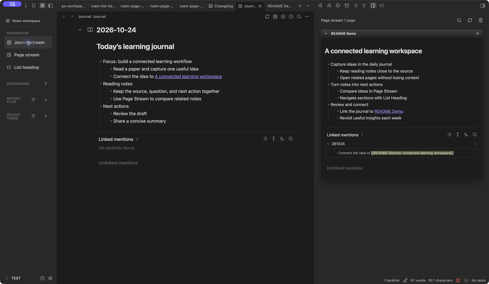
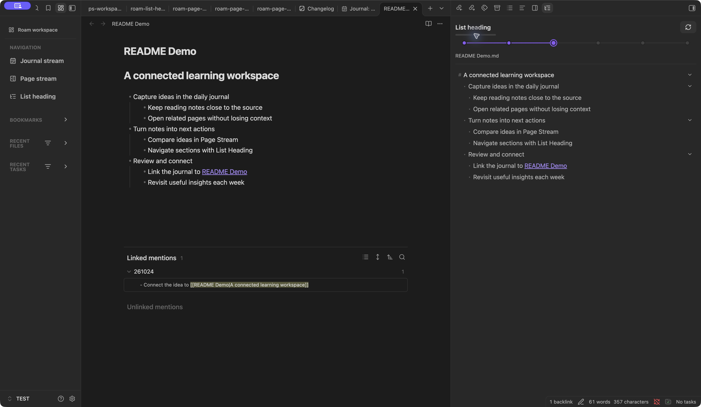
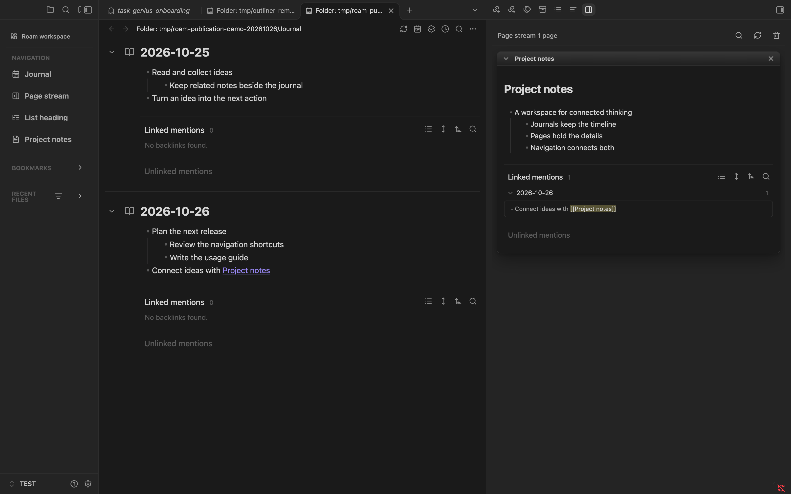

<table><tr><td width="180"></td><td>扫描二维码，加入终身学习者社群、交流群。<br>一起交流 AI、知识管理与效率工具。<br>公众号同名：湖畔的赛博格</td></tr></table>

---

# Roam Workspace

[English](README.md) | 简体中文

**把双链大纲笔记的工作流带进 Obsidian。** 如果你习惯 Logseq、Roam Research、虎鲸笔记（Orca Note）或[思源笔记](https://b3log.org/siyuan/)的使用方式，Roam Workspace 让你在现有 Obsidian 库中延续这类工作流：从日记记录想法，用嵌套列表梳理层次，通过双链连接笔记，再把关联页面并排展开、阅读和编辑。

将连续日记、Page Stream、自定义导航、分组书签和增强的列表大纲导航组合起来，同时保留 Obsidian 中可直接编辑的 Markdown 笔记。

## 界面预览

Journal 与 Page Stream：在日记旁打开关联页面，保留阅读和编辑上下文。



List Heading：按笔记中的真实列表层级导航。



截图来自 Obsidian 1.14.4，使用 GitHub 0.1.0 发布版和隔离 TEST 库中的演示笔记。

0.1.1 版本的导航、Journal 与 Page Stream，截图来自 Obsidian 1.14.4 隔离 TEST 库。



## 功能

- **Journal**：连续编辑日记或文件夹笔记，支持日期范围、排序、预设及 Markdown 导出。
- **Page Stream**：把多个关联页面放在一起，用嵌入式 Markdown 编辑器编辑。
- **自定义导航**：添加多个 Journal 文件夹、笔记链接和网页入口，通过设置或右键菜单修改名称、图标、显隐与顺序；高级 JSON 配置便于复用导航方案。
- **分组书签**：在导航中浏览 Obsidian 已有的嵌套书签组、文件夹和文件，并结合近期文件、近期任务及筛选条件组织工作区。
- **增强列表大纲**：按标题和嵌套列表层级导航，以紧凑行呈现结构，通过右键菜单按指定深度折叠或展开；限定范围的 Outliner 联动辅助列表编辑。

## Metadata Menu 联动

Roam Workspace 可与 [Metadata Menu](https://github.com/mdelobelle/metadatamenu) 联动，在 Navigation 导航面板中：

- 在文件行显示笔记对应的 FileClass 图标。
- 按 FileClass 筛选近期文件。
- 点击笔记旁的图标：已有 FileClass 时打开 Metadata Menu 的字段编辑窗口；尚未分配时调用其 FileClass 选择入口。无法定位具体操作时，回退到 Metadata Menu 的原生上下文菜单。

在同一个库中安装并启用两个插件，在 Metadata Menu 中配置 FileClass，等待其索引完成，再打开 **Roam Workspace: Open roam navigation**。

**兼容范围：**当前适配器针对 Metadata Menu **0.8.12**，启用联动前会检查版本和就绪状态；其他版本目前不会启用这些适配能力。Metadata Menu 为可选插件：未安装、版本不匹配或尚未就绪时，Roam Workspace 使用普通文件图标，并打开笔记的原生属性区域。联动使用 Metadata Menu 已有的分类与字段编辑功能，字段定义仍在 Metadata Menu 中配置。

## 安装

从 [最新发布页](https://github.com/PkuLilBoat/roam-workspace/releases/latest) 下载 `main.js`、`manifest.json`、`styles.css`，直接放进 `<库>/<配置目录>/plugins/roam-workspace/`，配置目录通常是 `.obsidian`。重载 Obsidian，必要时允许使用第三方插件，在设置中启用 **Roam Workspace**。源码 ZIP 不包含 `main.js`。

更新前备份原插件文件夹并保留 `data.json`。插件 ID 是 `roam-workspace`；旧的 `roam-in-ob` 和 Daily Notes Editor 是不同安装。兼容性排查时可关闭功能重叠的插件，不要自动删除或迁移它们的数据。

当前是供手动安装的开发快照，尚未进入 Obsidian 官方社区目录。manifest 声明最低版本 1.8.7、非仅桌面，但本次未独立完成最低版本及移动端兼容矩阵验证，建议先在测试库试用。

## 使用与设置

在命令面板执行 **Roam Workspace: Open journal stream**、**Open page stream**、**Open roam navigation** 或 **Open list heading**。先在插件设置中选择日记文件夹，默认是 `Journal`。设置还包括启动行为、日期范围、预设、来源路径、frontmatter、反向链接、导航筛选、近期任务及 Outliner 作用范围；近期任务默认关闭。

## 隐私与 AI

笔记和插件设置保存在本地库。本插件不内置 AI 服务、AI 账号或 MCP。外部本地 AI 助手可以协助安装三个文件、编辑配置；其权限与隐私政策另行适用。发布包不包含个人 `data.json`、笔记和本地多库部署目标。公开副本的部署清单为空；安装者不要运行作者的多库部署脚本。

## 开发

```sh
pnpm install --frozen-lockfile
pnpm run build
pnpm run test:journal
pnpm run test:compat-quality
pnpm run test:navigation
pnpm run lint
```

`build` 包含 Svelte/TypeScript 检查，并生成 `main.js`、`styles.css` 与构建指纹。实际检查结果见发布说明。运行时审计脚本绑定维护者本地 TEST 库，不是通用安装命令。

## 来源与许可

**PkuLilBoat 拥有版权的原创贡献允许非商业使用；商业使用必须事先取得 PkuLilBoat 的明确书面授权。** 具体范围和条款见 [LICENSE](LICENSE)。商业使用包括企业内部业务使用、收费客户项目、转售、收费托管与付费产品集成。可通过 [GitHub Issues](https://github.com/PkuLilBoat/roam-workspace/issues) 或上方维护者联系方式申请；提出申请不等于取得许可。此为源码可见的自定义许可，不属于 OSI 认可的开源许可证。

非商业分发时，须保留许可证及适用声明，并在分发页面或随附说明中清晰注明原作者 PkuLilBoat、项目名称 Roam Workspace 和[原始 GitHub 仓库链接](https://github.com/PkuLilBoat/roam-workspace)。修改版须说明已作修改及主要改动，不得冒充原作者的官方版本。

Roam Workspace 由 PkuLilBoat 维护。维护者确认，早期基础实现已经在后续开发中全部重写；原先将当前项目描述为继承 Daily Notes Editor 代码的说明据此更新。插件安装 ID 为 `roam-workspace`。

原创贡献许可不覆盖单独保留的第三方组件；Hover Editor、Outliner 及依赖仍适用各自版权、许可与署名要求，详见[第三方声明](THIRD_PARTY_NOTICES.md)。

## 反馈

欢迎通过 [GitHub Issues](https://github.com/PkuLilBoat/roam-workspace/issues) 反馈问题或建议。
